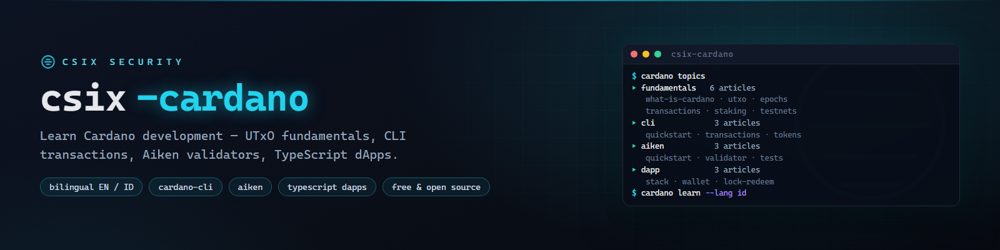

# csix-cardano



**Basis belajar Cardano gratis dua bahasa (EN/ID) — dasar-dasar, cardano-cli, validator Aiken, dan contoh dApp TypeScript.**

[](https://github.com/siedysoes/csix-cardano/actions/workflows/ci.yml)
[](LICENSE)
[](https://siedysoes.github.io/csix-cardano/)

`csix-cardano` adalah basis pengetahuan yang terstruktur dan ramah pemula untuk
belajar pengembangan Cardano — artikel pendek, praktis, dan saling terhubung
dengan contoh kode yang bisa dijalankan: perintah cardano-cli, kontrak pintar
Aiken, dan kode off-chain TypeScript dengan Mesh.

> 🌐 **Baca di web:** **https://siedysoes.github.io/csix-cardano/**

## Isi

### Fundamental (6 artikel)

| Artikel | Yang akan Anda pelajari |
|---------|-------------------------|
| [Apa Itu Cardano](id/fundamentals/what-is-cardano.md) | PoS, Ouroboros, era, suplai ADA, governance |
| [Model UTxO](id/fundamentals/utxo-model.md) | UTxO vs model akun, eUTxO, datum & redeemer |
| [Epoch, Slot & Waktu](id/fundamentals/epochs-and-time.md) | Slot 1 detik, epoch 5 hari, finalitas, timing di validator |
| [Transaksi & Alamat](id/fundamentals/transactions-and-addresses.md) | Anatomi transaksi, fee, alamat base/enterprise/reward |
| [Staking & Delegasi](id/fundamentals/staking-and-delegation.md) | Delegasi non-kustodial, pool, reward, tanpa lockup |
| [Testnet Cardano](id/fundamentals/cardano-testnets.md) | Preprod vs preview, faucet, explorer, network magic |

### cardano-cli (3 artikel)

| Artikel | Yang akan Anda pelajari |
|---------|-------------------------|
| [Quickstart cardano-cli](id/cli/cli-quickstart.md) | Kunci, alamat, query, testnet magic, menjalankan node testnet |
| [Membangun Transaksi dengan cardano-cli](id/cli/cli-transactions.md) | Build → sign → view → submit, fee, min-UTxO |
| [Native Token & Minting](id/cli/cli-native-tokens.md) | Asset id, kebijakan minting, mint & burn |

### Kontrak Pintar Aiken (3 artikel)

| Artikel | Yang akan Anda pelajari |
|---------|-------------------------|
| [Quickstart Aiken](id/aiken/aiken-quickstart.md) | Instalasi, struktur proyek, check/build/blueprint |
| [Validator Pertama Anda](id/aiken/aiken-first-validator.md) | Datum, redeemer, handler spend, kode hello-world lengkap |
| [Tes & Pola Umum](id/aiken/aiken-tests-patterns.md) | `test`, properti fuzz, execution unit, pola desain |

### dApp TypeScript (3 artikel)

| Artikel | Yang akan Anda pelajari |
|---------|-------------------------|
| [Stack dApp Cardano](id/dapp/dapp-stack.md) | Mesh vs Lucid, provider, wallet CIP-30 |
| [Hubungkan Wallet & Kirim ADA](id/dapp/dapp-connect-wallet.md) | MeshWallet, BlockfrostProvider, build/sign/submit |
| [Kunci & Tebus Dana di Script](id/dapp/dapp-lock-redeem.md) | Blueprint → alamat script → lock → redeem, ujung ke ujung |

Setiap artikel tersedia dalam **English** (`en/`) dan **Bahasa Indonesia** (`id/`).

## Baca di web

Situsnya adalah aplikasi statis satu halaman (tanpa server, tanpa pelacakan)
yang dijalankan GitHub Pages — merender file Markdown dari repo ini secara langsung:

- 🌐 **https://siedysoes.github.io/csix-cardano/**
- Tombol ganti bahasa **EN ↔ ID** di bar atas
- Kotak pencarian memfilter topik saat Anda mengetik
- Link di dalam artikel navigasi tanpa reload halaman

## Struktur repositori

```
csix-cardano/
├── index.html        # cangkang aplikasi web
├── app.js            # router + pencarian + ganti bahasa
├── style.css         # tema gelap
├── topics.json       # manifest topik (judul + jalur, EN/ID)
├── assets/           # banner
├── en/               # artikel English
│   ├── fundamentals/
│   ├── cli/
│   ├── aiken/
│   └── dapp/
├── id/               # artikel Indonesia
│   ├── fundamentals/
│   ├── cli/
│   ├── aiken/
│   └── dapp/
└── .github/workflows # CI: validasi link + manifest
```

## Menjalankan contoh kode

- **cardano-cli / Aiken**: khusus testnet. Ambil test ADA dari faucet resmi dan
  ikuti dokumen instalasi (docs.cardano.org, aiken-lang.org).
- **TypeScript**: `npm install @meshsdk/core tsx`, lalu `npx tsx <file>.ts`.
  Blockfrost butuh project id gratis untuk jaringan testnet.

Semua contoh menyasar **jaringan test**. Jangan pernah menempelkan kunci asli ke
dalam contoh, dan selalu cocokkan versi tool terkini dengan dokumen resmi —
dunia ini bergerak cepat.

## Berkontribusi

1. Fork, lalu tambah/ubah Markdown di `en/` (dan terjemahkan di `id/`).
2. Daftarkan topik baru di `topics.json` (kedua bahasa).
3. Buka pull request — CI memastikan semua link dan entri manifest valid.

Gaya artikel: Markdown murni, tanpa front matter, baris pertama `# Judul`,
diakhiri satu bagian `## See also` berisi link relatif.

## Bahasa

- [English](README.md)
- Bahasa Indonesia (file ini)

## Lisensi

MIT — lihat [LICENSE](LICENSE). Konten bebas dipelajari, dibagikan, dan
diadaptasi dengan atribusi.
