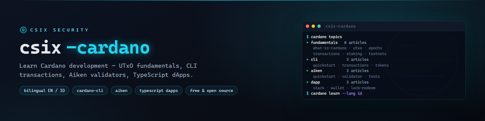

# csix-cardano



**Free bilingual (EN/ID) Cardano learning base — fundamentals, cardano-cli, Aiken validators, and TypeScript dApp examples.**

[](https://github.com/siedysoes/csix-cardano/actions/workflows/ci.yml)
[](LICENSE)
[](https://siedysoes.github.io/csix-cardano/)

`csix-cardano` is a structured, beginner-friendly knowledge base for learning
Cardano development — short, practical, cross-linked articles with runnable
code examples: cardano-cli commands, Aiken smart contracts, and TypeScript
off-chain code built with Mesh.

> 🌐 **Read it on the web:** **https://siedysoes.github.io/csix-cardano/**

## What's inside

### Fundamentals (6 articles)

| Article | You'll learn |
|---------|--------------|
| [What Is Cardano](en/fundamentals/what-is-cardano.md) | PoS, Ouroboros, eras, ADA supply, governance |
| [The UTxO Model](en/fundamentals/utxo-model.md) | UTxO vs account model, eUTxO, datum & redeemer |
| [Epochs, Slots & Time](en/fundamentals/epochs-and-time.md) | 1-second slots, 5-day epochs, finality, timing in validators |
| [Transactions & Addresses](en/fundamentals/transactions-and-addresses.md) | Tx anatomy, fees, base/enterprise/reward addresses |
| [Staking & Delegation](en/fundamentals/staking-and-delegation.md) | Non-custodial delegation, pools, rewards, no lockup |
| [Cardano Testnets](en/fundamentals/cardano-testnets.md) | Preprod vs preview, faucet, explorers, network magic |

### cardano-cli (3 articles)

| Article | You'll learn |
|---------|--------------|
| [cardano-cli Quickstart](en/cli/cli-quickstart.md) | Keys, addresses, queries, testnet magic, running a testnet node |
| [Building Transactions with cardano-cli](en/cli/cli-transactions.md) | Build → sign → view → submit, fees, min-UTxO |
| [Native Tokens & Minting](en/cli/cli-native-tokens.md) | Asset ids, minting policies, mint & burn |

### Aiken Smart Contracts (3 articles)

| Article | You'll learn |
|---------|--------------|
| [Aiken Quickstart](en/aiken/aiken-quickstart.md) | Install, project layout, check/build/blueprint |
| [Your First Validator](en/aiken/aiken-first-validator.md) | datum, redeemer, spend handler, full hello-world code |
| [Tests & Common Patterns](en/aiken/aiken-tests-patterns.md) | `test`, fuzz properties, execution units, design patterns |

### TypeScript dApps (3 articles)

| Article | You'll learn |
|---------|--------------|
| [The Cardano dApp Stack](en/dapp/dapp-stack.md) | Mesh vs Lucid, providers, CIP-30 wallets |
| [Connect a Wallet & Send ADA](en/dapp/dapp-connect-wallet.md) | MeshWallet, BlockfrostProvider, build/sign/submit |
| [Lock & Redeem Script Funds](en/dapp/dapp-lock-redeem.md) | Blueprint → script address → lock → redeem, end to end |

Every article exists in **English** (`en/`) and **Indonesian** (`id/`).

## Read on the web

The site is a static single-page app (no server, no tracking) served by
GitHub Pages — it renders the Markdown files from this repo live:

- 🌐 **https://siedysoes.github.io/csix-cardano/**
- Language toggle **EN ↔ ID** in the top bar
- Search box filters topics as you type
- In-article links navigate without page reloads

## Repository layout

```
csix-cardano/
├── index.html        # web app shell
├── app.js            # router + search + language toggle
├── style.css         # dark theme
├── topics.json       # topic manifest (titles + paths, EN/ID)
├── assets/           # banner
├── en/               # English articles
│   ├── fundamentals/
│   ├── cli/
│   ├── aiken/
│   └── dapp/
├── id/               # Indonesian articles
│   ├── fundamentals/
│   ├── cli/
│   ├── aiken/
│   └── dapp/
└── .github/workflows # CI: link + manifest validation
```

## Running the code examples

- **cardano-cli / Aiken**: testnet only. Use the official faucet for test ADA
  and follow the install docs (docs.cardano.org, aiken-lang.org).
- **TypeScript**: `npm install @meshsdk/core tsx`, then `npx tsx <file>.ts`.
  Blockfrost needs a free project id for the testnet network.

All examples target **test networks**. Never paste real keys into examples,
and verify current tool versions against official docs — this space moves fast.

## Contribute

1. Fork and add/edit Markdown under `en/` (and translate under `id/`).
2. Register new topics in `topics.json` (both languages).
3. Open a pull request — CI checks that all links and manifest entries resolve.

Article style: pure Markdown, no front matter, `# Title` first line,
one `## See also` section with relative links at the end.

## Languages

- English (this file)
- [Bahasa Indonesia](README.id.md)

## License

MIT — see [LICENSE](LICENSE). Content is free to learn from, share, and adapt
with attribution.
